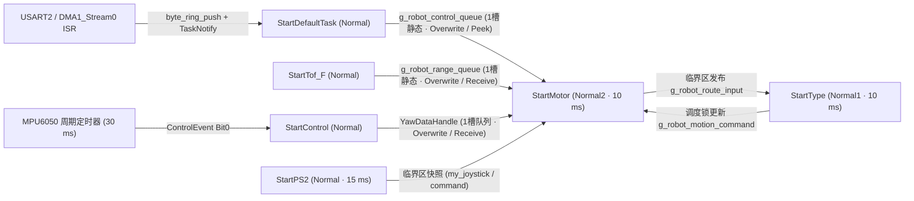
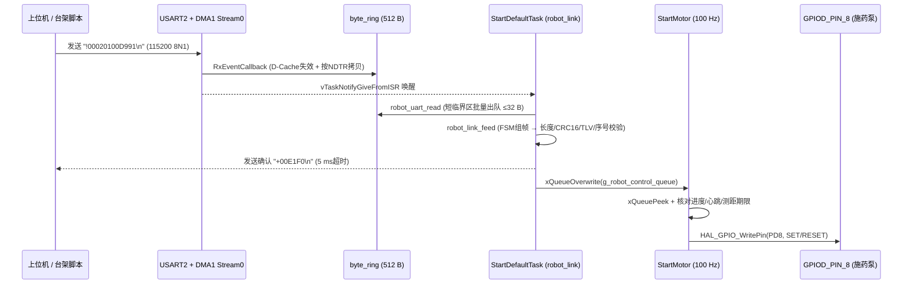
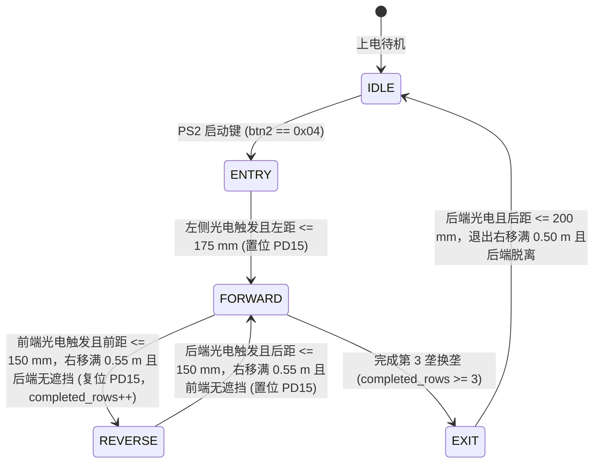

# Agricultural_robot 工程指南

> 本文为 **Agricultural_robot** 车端固件（STM32H750VBT6 + FreeRTOS）的深度技术手册，面向固件开发者与工程评审，详细说明板级硬件映射、FreeRTOS 任务并发契约、串口协议字节级规范、闭环控制与自主导航状态机、故障安全判定条件，以及 Cortex-M7 指令级固件仿真复现方法。

[← 返回项目首页与实机演示](README.md)

**目录**：[硬件与源码入口](#硬件与源码入口) · [任务间的数据传递](#任务间的数据传递) · [串口通信与协议规范](#串口通信与协议规范) · [运动控制与自主换垄导航](#运动控制与自主换垄导航) · [停车条件](#停车条件) · [复现固件仿真](#复现固件仿真)

---

## 硬件与源码入口

### 1. 系统时钟与内存布局要点

- **时钟树**（[main.c](Core/Src/main.c)）：内部高速时钟 HSI 经 PLL1（`M=4, N=60, P=2`）倍频至 **SYSCLK = 480 MHz**（VOS0，FLASH 4 Wait States）；AHB 分频为 **240 MHz**，APB1/2/3/4 为 **120 MHz**，各定时器内核时钟为 **240 MHz**。
- **时基分工**：`TIM6` 为 HAL 库提供 1 ms 滴答时基（`HAL_IncTick`），与 FreeRTOS 的 `SysTick`（1000 Hz）解耦；`TIM7` 配置为 240 分频（1 MHz，1 µs/tick）供手柄与测距任务读取微秒计数（[tim.c](Core/Src/tim.c)）。
- **DMA 专用缓存区**：USART2 RX 循环 DMA 缓冲区显式定位于 RM0433 的 **D2 SRAM1 起始地址 `0x30000000`**（独占 256 B，按 Cortex-M7 32 B 缓存行对齐），避开 MDK 默认链接使用的 DTCM 与 AXI SRAM，并配合 `SCB_InvalidateDCache_by_Addr()` 维护缓存一致性（[robot_uart.c](BSP/robot_uart.c)）。

### 2. 板级外设接线与源码索引

| 子系统 | 硬件资源 / 引脚分配 | 关键参数与电气语义 | 源码或配置入口 |
| --- | --- | --- | --- |
| 主控与调度 | STM32H750VBT6（Cortex-M7 @ 480 MHz） | FreeRTOS V10.3.1（CMSIS-RTOS v2，heap_4 20 KB，抢占式调度） | [RTOS_HAL.ioc](RTOS_HAL.ioc) · [FreeRTOSConfig.h](Core/Inc/FreeRTOSConfig.h) · [freertos.c](Core/Src/freertos.c) |
| 四轮电机输出 | A：`PC4/PC5` + `TIM12_CH1(PB14)`；B：`PB0/PB1` + `TIM12_CH2(PB15)`；C：`PB2/PE7` + `TIM15_CH1(PE5)`；D：`PE8/PE9` + `TIM15_CH2(PE6)` | 240 MHz / 240 / 100 = **10 kHz PWM**，占空比范围 `0..100`；表驱动通道抽象 | [robot_motor.c](BSP/robot_motor.c) · [tim.c](Core/Src/tim.c) |
| 四轮编码器 | A：`TIM4(PD12/PD13)`；B：`TIM3(PA6/PA7)`；C：`TIM5(PA0/PA1)`；D：`TIM2(PA5/PB3)` | TI12 四倍频，`11 × 30 × 4 = 1320 CPR`；B/D 轮符号取反；D 轮兼作横移里程参考轮 | [tim.c](Core/Src/tim.c) · [freertos.c](Core/Src/freertos.c) |
| 激光测距（×3） | 前/后/左 VL53L0X 共用软件 I²C，XSHUT 依次为 `PE0`、`PE3`、`PD11` | 上电全关后逐台唤醒改址，写地址依次为 `0x54`、`0x56`、`0x58`（7 位 `0x2A/0x2B/0x2C`）；仅采纳 `RangeStatus == 0` 样本 | [robot_range.c](BSP/robot_range.c) · [vl53l0x.c](VL53L0X/demo/vl53l0x.c) |
| 光电到位开关 | `PA9`（前）、`PA10`（后）、`PA11`（左） | 上拉输入、**低电平有效**；与激光测距形成双传感器联锁 | [gpio.c](Core/Src/gpio.c) · [freertos.c](Core/Src/freertos.c) |
| 姿态传感器 | MPU6050（硬件 I²C，片上 DMP） | 30 ms 软件定时器触发读取四元数解算偏航角（单位：度），过滤 `NaN`/无穷大 | [MPU6050.c](MPU6050/MPU6050.c) · [freertos.c](Core/Src/freertos.c) |
| 施药泵与指示 | `PD8`（施药泵）、`PD15`（行进方向指示） | `PD8` 高开低关，上电与故障时默认复位；`PD15` 前进置位、倒车复位 | [gpio.c](Core/Src/gpio.c) · [freertos.c](Core/Src/freertos.c) |
| 通信与调试串口 | `USART2(PA2/PA3)` + `DMA1_Stream0`；`UART5(PB12/PB13)` | USART2 115200 8N1 负责上下位机可靠链路；UART5 重定向 `fputc`/`fgetc` 供串口调试 | [robot_uart.c](BSP/robot_uart.c) · [usart.c](Core/Src/usart.c) · [main.c](Core/Src/main.c) |
| 现场手柄控制 | PS2 无线手柄（PC 组软件时序引脚） | 15 ms 周期扫描；模拟模式（`0x73`）手动驾驶，`btn2 == 0x04` 触发自动路线起步 | [ps2.c](PS2/ps2.c) · [freertos.c](Core/Src/freertos.c) |
| 独立看门狗 | `IWDG1` | 32 kHz LSI / 32 分频，`RLR = 1999`（标称约 **2.0 s** 超时），配置同步限时 100 ms | [robot_watchdog.c](BSP/robot_watchdog.c) |

---

## 任务间的数据传递

### 1. 并发数据流拓扑



### 2. 任务配置与优先级设计

| 任务 / 对象 | 入口函数 | 优先级 | 栈大小 | 周期 / 触发机制 | 设计原则 |
| --- | --- | --- | --- | --- | --- |
| 电机控制任务 | `StartMotor` | `osPriorityNormal2` | 4096 B | 10 ms 周期（100 Hz） | 最高业务优先级，保证闭环采样、安全裁决、PWM/水泵写入与喂狗节拍稳定 |
| 自动导航任务 | `StartType` | `osPriorityNormal1` | 2048 B | 10 ms 周期 | 次高优先级，基于电机任务发布的同周期快照推进状态机 |
| 通信解析任务 | `StartDefaultTask` | `osPriorityNormal` | 2048 B | ISR `ulTaskNotifyTake` + 20 ms 监督唤醒 | 事件驱动降低空转，同时以 20 ms 上限周期监督心跳与恢复异常 DMA |
| 测距采集任务 | `StartTof_F` | `osPriorityNormal` | 2048 B | 10 ms 延时 + 三路串行阻塞测距 | 将耗时的软件 I²C 单次测距与高速电机控制完全隔离 |
| 姿态读取任务 | `StartControl` | `osPriorityNormal` | 2048 B | 30 ms 软件定时器 + `EventFlags` | 定时唤醒读取 DMP FIFO，避免在定时器回调中执行阻塞 I²C |
| 手柄扫描任务 | `StartPS2` | `osPriorityNormal` | 512 B | 15 ms 周期 | 独立扫描手柄，隔离软件位操作延时 |

### 3. 队列与共享状态并发契约

| 生产者 | 同步载体 | 传递字段 | 消费者与消费策略 |
| --- | --- | --- | --- |
| `StartDefaultTask` | `g_robot_control_queue`（容量 1，静态队列） | `progress_ms`、`heartbeat_ms`、`legacy_request_ms`、`spray_request`、`supervised`、`stopped` | `StartMotor` 每周期非阻塞 **`xQueuePeek()`**：即使无新帧到达，电机任务每轮仍基于最新快照重新核对心跳与进度期限 |
| `StartTof_F` | `g_robot_range_queue`（容量 1，静态队列） | 前/后/左距离（mm）、`started_ms`（第一路采样前时间戳）、`valid` | `StartMotor` 非阻塞 **`xQueueReceive()`**：仅消费最新一组样本；三路中任一路失败即整组标为无效；未收到新样本时保留上次样本直至满 500 ms 过期 |
| `StartControl` | `YawDataHandle`（容量 1） | 有限浮点数 `yaw_deg`（度） | `StartMotor` 非阻塞取出最新偏航角并更新航向 PID 纠偏量 |
| `StartMotor` | `g_robot_route_input`（临界区保护） | `range_valid`、三路光电、三路测距、`reference_rpm` | `StartType` 在 `vTaskSuspendAll()` 调度锁内读取同周期一致快照并更新 `g_robot_motion_command`，调度锁期间外设中断仍可正常响应 |

> **为什么使用“容量为 1 的静态覆盖队列”？**
> 传感器与控制状态属于典型的「最新值有效（Last-Value-Wins）」语义。例如测距任务连续发布 `(10, 20, 30)` mm 与 `(40, 50, 60)` mm 两组样本时，采用 `xQueueOverwrite()` 自动淘汰旧值，电机任务始终直接处理 `(40, 50, 60)` mm，避免队列积压导致的控制相位滞后。该行为已由固件仿真用例 `test_latest_control` 与 `test_latest_range` 直接运行 FreeRTOS 内核队列代码验证（[check_firmware_elf.py](tests/check_firmware_elf.py)）。

---

## 串口通信与协议规范

### 1. 一条控制指令的端到端生效路径



### 2. DMA 循环接收与容错机制

- **多事件协同**：`HAL_UARTEx_ReceiveToIdle_DMA()` 同时启用空闲中断（IDLE）、半满（HT）和全满（TC）中断。由于三类事件可能紧邻触发，`HAL_UARTEx_RxEventCallback()` 不依赖回调参数 `size`，而是读取实时 `NDTR` 计算写入指针增量，逐字节推入 `byte_ring`（[robot_uart.c](BSP/robot_uart.c)）。
- **防静默回绕覆盖**：在 `DMA1_Stream0_IRQHandler()` 中检测 HT 与 TC 标志是否同时挂起；若同时积压或 `byte_ring_push()` 满溢，立即置位 `g_robot_uart_fault` 锁存字节流缺口故障，由 `StartDefaultTask` 停止当前帧、切入 `ROBOT_LINK_DROP_LINE` 丢弃残帧至下一换行并重建 DMA，同时锁存停车保护。
- **中断优先级约束**：`USART2_IRQn` 与 `DMA1_Stream0_IRQn` 优先级均设为 `configLIBRARY_MAX_SYSCALL_INTERRUPT_PRIORITY`（数值 `5`），满足在 ISR 中安全调用 `vTaskNotifyGiveFromISR()` 的 FreeRTOS 约束；且消费者仅需通过临界区屏蔽同级及以下中断即可原子出队。

### 3. 帧格式、CRC 与 TLV 定义

详细契约见 [robot_link.h](modules/robot_link.h) 与 [robot_link.c](modules/robot_link.c)：

- **帧结构**：请求行以 `!` 起始、`\n`（兼容 `\r\n`）结束，中间全部为大写十六进制字符（单行上限 100 字节）：
  - `Seq`（1 B）：帧序号，会话建立后按模 256 严格递增；
  - `Len`（1 B）：TLV 载荷字节数，上限 `32 B`；
  - `TLV Payload`（0..32 B）：每项为 `Type(1 B) + Length(1 B) + Value(Length B)`；
  - `CRC-16`（2 B，大端）：**CRC-16/CCITT-FALSE**（初值 `0xFFFF`，多项式 `0x1021`，高位先行），覆盖**二进制**的 `Seq + Len + TLV Payload`。
- **确认帧（ACK）**：固定 8 字节 `+ <Seq:2Hex> <CRC16(Seq):4Hex> \n`。
- **TLV 命令表**（表驱动 `g_robot_link_rules[]`）：

| Type | Length | Value 含义 | 校验与原子语义 |
| --- | --- | --- | --- |
| `0x01` | `0x00` | 心跳（Heartbeat） | 同一帧内不可重复出现；首帧**必须**含心跳且不得携带施药指令 |
| `0x02` | `0x01` | `0x00` 关泵 / `0x01` 开泵 | `Value > 1` 或重复出现则整帧丢弃 |
| 未知 Type | 任意合法长度 | 前向扩展预留字段 | 先校验剩余载荷足够再按 `Length` 跳过；一帧内须至少包含一个已知字段 |

- **停等重传与去重语义**：
  - 接收端缓存最近一帧的二进制内容与序号；若上位机因 ACK 丢失而**原样重传**相同序号帧，接收端标记 `event.duplicate = true` 并重发 ACK，业务回调不重复执行动作，也不刷新心跳期限。
  - 若同序号但载荷不同、跳号、超长、越界 TLV 或 CRC 错误，整帧丢弃并递增 `errors` 计数，不影响后续合法帧接收。
  - 上位机单独重启回退至序号 `0x00` 不会隐式重建会话，避免异常重启掩盖链路故障。
- **旧版协议兼容**：在尚未建立新会话（`!active`）时，允许接收 `@` 开头、含 `d`（开泵）或 `n`（关泵）的旧版文本行（不发送 ACK，且开泵请求受 500 ms 超时自动撤泵约束）；一旦建立新会话，旧协议立即失效且旧开泵状态清零。

### 4. 真实报文样例（已纳入单元测试）

| 场景 | 发送帧（ASCII + LF） | 解析说明 | 预期应答 / 行为 |
| --- | --- | --- | --- |
| 建立会话（0 号心跳） | `!00020100D991\n` | `Seq=00`, `Len=02`, TLV=`01 00`（心跳）, CRC=`D991` | 返回 `+00E1F0\n`，进入监督会话并启动 500 ms 心跳计时 |
| 含未知字段的开泵帧 | `!FF06770113020101EED3\n` | `Seq=FF`, `Len=06`, 跳过未知 TLV `77 01 13`，解码 `02 01 01`（开泵） | 返回对应 ACK，执行一次开泵；原样重发仅补发 ACK |
| 发送端重传逻辑 | [robot_peer.py](tests/robot_peer.py) | 默认单次等 ACK 50 ms，最多重发 3 次原帧 | 3 次均无合法 ACK 抛出 `TimeoutError` |

---

## 运动控制与自主换垄导航

### 1. 四轮运动学与双层 PID 参数

在 `StartMotor` 10 ms 周期内，底盘将目标速度 `(forward, lateral, rotation)` 分解为四轮目标转速（`ROBOT_ROTATION_ARM = 0.2F`），与四路编码器实测转速做增量式 PID 闭环（[freertos.c](Core/Src/freertos.c) · [pid.c](PID/pid.c)）：

```text
turn       = rotation * 0.2
target[A]  = forward - lateral - turn    // TIM4 编码器 -> TIM12_CH1 PWM
target[B]  = forward + lateral + turn    // TIM3 编码器(取反) -> TIM12_CH2 PWM
target[C]  = forward + lateral - turn    // TIM5 编码器 -> TIM15_CH1 PWM
target[D]  = forward - lateral + turn    // TIM2 编码器(取反) -> TIM15_CH2 PWM
```

| PID 实例 | 类型 | 增益 `(Kp, Ki, Kd)` | `max_out` / `max_iout` | 作用与说明 |
| --- | --- | --- | --- | --- |
| `g_robot_wheel_pid[0..3]` | 增量式（`PID_DELTA`） | `(5.0, 0.2, 0.0)` | `100.0` / `5.0` | 四轮速度内环，直接输出有符号 PWM 比较值 |
| `g_robot_yaw_pid` | 位置式（`PID_POSITION`） | `(2.5, 0.0, 0.3)` | `500.0` / `5.0` | 目标偏航角 `0°`，维持沿垄与横移直行姿态 |
| `g_robot_front_rear_range_pid` | 位置式（`PID_POSITION`） | `(0.15, 0.0, 0.005)` | `100.0` / `5.0` | 垄端前/后距减速外环，目标距离 `100 mm` |
| `g_robot_left_range_pid` | 位置式（`PID_POSITION`） | `(0.5, 0.0, 0.02)` | `100.0` / `5.0` | 左侧沿垄纠偏外环，目标侧距 `80 mm`（无左侧光电或距离 `> 200 mm` 时归零） |

### 2. 自主换垄状态机与手动接管

`StartType` 维护跨周期状态 `robot_route_state`，仅在 **非 PS2 模拟模式**、**已按下启动键（`g_robot_route_enabled`）** 且 **当前测距有效** 时推进状态机。横移里程由 D 轮参考转速按轮径 `0.08 m` 积分估算（入垄 `0.50 m`、换垄 `0.55 m`、退出 `0.50 m`），完成 3 垄作业后自动退出并停车：



> **手动优先级**：当 PS2 手柄切换至模拟模式（`mode == 0x73`）时，`StartPS2` 按「旋转 > 横移 > 前后」解码摇杆直接控制底盘，同时暂停自动导航状态机推进，便于现场人工对位。

---

## 停车条件

系统在控制周期、协议监督与硬件异常入口设置了五道独立防线，确保任意链路异常均收敛到「四轮 PWM 归零 + PD8 关泵」的安全态（[freertos.c](Core/Src/freertos.c) · [robot_watchdog.c](BSP/robot_watchdog.c) · [robot_motor.c](BSP/robot_motor.c)）：

| 触发条件 | 判定阈值 | 固件动作 | 锁存与恢复策略 |
| --- | --- | --- | --- |
| 自动导航测距失效或陈旧 | 三路任一读数失败，或 `now_ms - started_ms >= 500 ms` | 暂停自动底盘驱动（清零 PWM、轮速 PID 与编码器）；自动路线已启动时同步拉低 `PD8` 关泵 | **非锁存**：测距恢复有效后自动解除暂停 |
| 已建立会话后心跳超时 | `now_ms - heartbeat_ms >= 500 ms`（仅新序号有效心跳续期） | **锁存停车**：撤销四轮 PWM 与 `PD8` 泵输出 | **永久锁存**：重新发送心跳仍保持停车，人工确认安全后复位 |
| 通信任务失去进度 | `now_ms - progress_ms >= 250 ms` | 电机任务**锁存停车**，并停止调用 `robot_watchdog_refresh()` | 通信持续失活约 **2 s** 后由 `IWDG1` 强制硬件复位 |
| 旧协议开泵请求超时 | 非会话模式下 `now_ms - legacy_request_ms >= 500 ms` | 通信任务发布与电机任务消费时双端核对并撤泵 | 收到新一帧有效旧指令可再次生效 |
| 致命故障 / 内核断言 | `NMI`、`HardFault`、`MemManage`、`BusFault`、`UsageFault`、`configASSERT` | 统一进入 `Error_Handler()`：关中断，先检测 RCC 时钟使能，仅对已供钟的 `GPIOD` 复位 `PD8`、对 `TIM12/TIM15` 写 `CCR1=CCR2=0` 并置位 `EGR.UG` 使零占空比立即生效 | 停在故障死循环；若 `IWDG1` 已启动则由看门狗复位 |

> **工程时序说明**：
> 1. 所有毫秒差值均采用 32 位无符号减法 `(uint32_t)(now_ms - prev_ms) >= limit`，天然免疫 49.7 天 `HAL_GetTick()` 回绕。
> 2. 表中时间为固件内部判定阈值。从末次心跳到物理引脚电平翻转的端到端延迟，还包含任务调度周期与执行器硬件关断时间，需结合示波器/逻辑分析仪在台架上实测确认。

---

## 复现固件仿真

项目采用 **「宿主机纯逻辑单测 + Cortex-M7 指令级固件仿真」** 两级离线验证体系，在无实板环境下即可覆盖协议边界、DMA 回绕、FreeRTOS 单槽队列覆盖与异常停机寄存器写入。

### 1. 环境准备与执行命令

宿主机单测（`byte_ring`、`robot_link`、`robot_peer`）运行方式见 [首页快速开始](README.md#快速开始)。

要运行 Cortex-M7 固件仿真回归，准备以下环境：

- **Arm GNU 工具链**：`arm-none-eabi-gcc`（含 `newlib-nano`）
- **ST 官方固件包**：`STM32Cube_FW_H7_V1.11.0`（提供 GCC 启动汇编 `startup_stm32h750xx.s`、FreeRTOS GCC 移植层 `ARM_CM4F/port.c` 与链接脚本）
- **Python 依赖**：Python 3.8+、`unicorn>=2,<3`、`pyelftools`

在仓库根目录执行（将 `--cube` 路径替换为本机固件包目录）：

```bash
python -m pip install "unicorn>=2,<3" pyelftools
python tests/run_firmware_checks.py --cube "/path/to/STM32Cube_FW_H7_V1.11.0"
```

### 2. 仿真原理与内存映射

1. [run_firmware_checks.py](tests/run_firmware_checks.py) 自动解析 Keil 工程 [RTOS_HAL.uvprojx](MDK-ARM/RTOS_HAL.uvprojx) 中目标 `RTOS_HAL` 的宏定义、头文件目录与源码清单，替换 GCC 启动与移植层后交叉编译链接生成临时 `robot.elf`。
2. [check_firmware_elf.py](tests/check_firmware_elf.py) 在 **Unicorn 2（`UC_CPU_ARM_CORTEX_M7` Thumb 模式）** 中映射 Flash（`0x08000000`）、DTCM（`0x20000000`）、D2 SRAM1 DMA 区（`0x30000000`）及外设/内核寄存器空间，加载 ELF 段与符号表，通过指令入口 Hook 精确控制 `HAL_GetTick()`、`vTaskDelay()` 与串口输入，并直接断言硬件寄存器写入结果（如 `GPIOD->BSRR`、`TIM12/TIM15->CCR1/CCR2/EGR`）。

### 3. 9 项固件仿真回归用例清单

| 用例名 | 验证目标 | 核心断言 |
| --- | --- | --- |
| `test_latest_control` | 通信单槽队列覆盖语义 | 连续发布 `@d` / `@n` 后，慢速电机任务直接按最新指令更新 `GPIOD->BSRR` |
| `test_latest_range` | 测距单槽队列覆盖语义 | 测距任务连续发布 `(10,20,30)` 与 `(40,50,60)` mm，消费者仅读到第二组且队列变空 |
| `test_legacy_deadline` | 旧协议开泵 500 ms 期限边界 | 499 ms 仍保持开泵（`PUMP_SET`），满 500 ms 立即关泵（`PUMP_RESET`） |
| `test_heartbeat_during_blocked_ack` | ACK 发送阻塞期间心跳边界 | 重复帧 ACK 阻塞跨过 500 ms 边界后，后续到达的新帧不再续期或确认 |
| `test_heartbeat_stops_outputs_until_reset` | 心跳超时停机与锁存语义 | 满 500 ms 后 `PD8` 复位且 `TIM12/15` 四路 `CCR` 清零；后续再发新心跳仍保持停车 |
| `test_lost_progress_stops_watchdog_refresh` | 通信进度 250 ms 超时与停喂狗 | 249 ms 正常喂狗并输出，250 ms 触发停机且停止递增喂狗计数；恢复发包仍锁存 |
| `test_fault_outputs` | 全部致命异常与 `configASSERT` 安全输出 | 遍历 `Error_Handler`、5 类 Cortex-M7 异常及 `xQueuePeek(NULL)` 触发内核断言，验证 `PD8` 复位、PWM 清零且 `TIMx->EGR.UG == 1` |
| `test_fault_before_clocks_enabled` | 外设未供钟前进入 `Error_Handler` | RCC 时钟位全 0 时，不访问未供钟的 `GPIOD` 与 `TIM12/15` 寄存器 |
| `test_dma_wrap` | USART2 DMA 循环缓冲回绕与重复回调 | 连续注入 2,048 字节模拟 8 圈 256 B 回绕，并在同一位置重复触发 `HAL_UARTEx_RxEventCallback()`，逐字节比对零丢包、零错序、无故障标志 |

> **仿真边界提示**：Unicorn 仿真验证的是真实固件机器码与 FreeRTOS 队列/协议逻辑，不能替代上板实测。Keil ARMCC 5.06 编译产物、硬件 PWM 波形、物理停泵响应时延及 `IWDG1` 真实 LSI 复位周期仍须在开发板与台架上确认。
