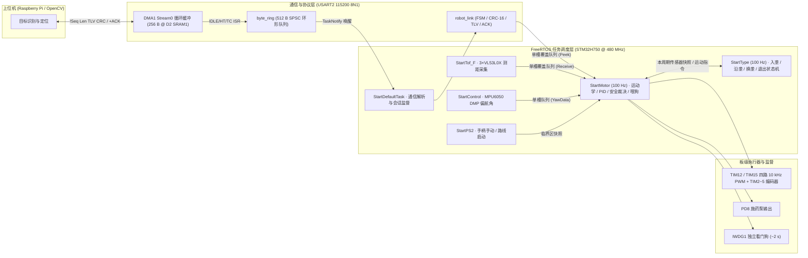

# Agricultural_robot

**面向果园垄道作业的对靶变量施药机器人车端实时控制固件**

[](RTOS_HAL.ioc)
[-2E7D32)](Core/Inc/FreeRTOSConfig.h)
[](modules/robot_link.h)
[](tests/check_firmware_elf.py)

[系统概述](#系统概述) · [工作演示](#工作演示) · [系统架构](#系统架构) · [核心子系统设计](#核心子系统设计) · [故障安全机制](#故障安全机制) · [快速开始](#快速开始) · [目录结构](#目录结构) · [工程指南](PROJECT_GUIDE.md)

---

## 系统概述

**Agricultural_robot** 是一套面向模拟果园垄道场景的对靶变量施药机器人系统，采用 **「上位机视觉感知 + 下位机实时控制」** 的异构解耦架构：

- **上位机（树莓派 / Linux + OpenCV）**：通过阈值分割与区域特征提取识别并定位果树目标，经由串口下发施药控制指令与会话心跳。
- **车端控制器（本仓库 · STM32H750VBT6 + FreeRTOS）**：独立承担四轮全向底盘闭环调速、多传感器融合沿垄纠偏、自主换垄状态机导航、高可靠串口协议栈与多级故障安全（Fail-Safe）保护，确保车端控制周期不受视觉推理帧率波动影响。

### 关键特性

- **实时多任务解耦**：基于 FreeRTOS 构建 6 个职责分离的任务，采用容量为 1 的静态覆盖队列（`xQueueOverwrite`）传递最新状态快照，避免慢消费导致的陈旧数据堆积。
- **四轮独立闭环与沿垄自主导航**：100 Hz 运动控制周期；结合 4 路正交编码器增量式 PID、3 路 VL53L0X ToF 测距、MPU6050 DMP 偏航角与 3 路光电开关，实现垄端平滑减速、定距沿垄纠偏与自动横移换垄。
- **工业级串口通信链路**：USART2 循环 DMA（D2 SRAM1 缓存行对齐 + D-Cache 失效）衔接 512 B 单生产者/单消费者环形队列；协议层实现逐字节状态机、CRC-16/CCITT-FALSE 校验、可扩展 TLV 载荷、表驱动分发及停等 ACK 幂等去重，并向下兼容旧版控制指令。
- **多级 Fail-Safe 与硬件监督**：覆盖心跳超时（500 ms）、通信任务失活（250 ms）、测距失效/陈旧（500 ms）、IWDG1 独立看门狗（~2 s）以及 Cortex-M7 异常/内核断言统一安全停机，故障触发后立即归零四路 PWM 并切断施药泵。
- **分层测试与指令级仿真回归**：核心通信模块与硬件解耦，支持宿主机 C99 严格模式单元测试，并内置基于 Arm GCC + Unicorn 2 的 Cortex-M7 固件 ELF 仿真测试套件，无需实板即可验证 DMA 回绕、任务快照与故障停车路径。

### 竞赛荣誉

| 赛事名称 | 获奖等级 |
| --- | --- |
| iCAN 大学生创新创业大赛“算能杯”RISC-V 开源技术挑战赛 | **国家级二等奖** |
| 国际大学生智能农业装备创新大赛 | **国家级优秀奖** |

---

## 工作演示

[](Docs/demo/机器人工作视频.mp4)

> 完整实拍视频（36 秒）：[观看《机器人工作视频》](Docs/demo/机器人工作视频.mp4)
>
> - **00:06** 样机沿模拟果园灰色垄道自主行驶并保持侧向定距；
> - **00:16** 俯视视角展示车身姿态纠偏与垄边间距控制；
> - **00:29** 全景展示垄端减速、横移换垄及相邻通道位置。

---

## 系统架构

### 软硬件协同与任务数据流



### 硬件平台与外设资源分配

STM32H750VBT6（Cortex-M7，**480 MHz** 主频，AHB 240 MHz）承担全部实时采集与控制任务。核心外设资源配置如下（详见 [CubeMX 工程](RTOS_HAL.ioc) 与 [定时器配置](Core/Src/tim.c)）：

| 模块 | 器件 / 片上外设 | 引脚与关键参数 | 系统职责 | 源码入口 |
| --- | --- | --- | --- | --- |
| 电机驱动 | TIM12 CH1~2、TIM15 CH1~2 + 8 路 GPIO | PB14/PB15、PE5/PE6（**10 kHz PWM**，ARR=99） | 四轮有符号 PWM 驱动与紧急零占空比停机 | [robot_motor.c](BSP/robot_motor.c) |
| 轮速反馈 | TIM2、TIM3、TIM4、TIM5（Encoder TI12） | PA5/PB3、PA6/PA7、PD12/PD13、PA0/PA1（1320 CPR） | 四轮独立测速；复用 D 轮估算横移里程 | [tim.c](Core/Src/tim.c) · [freertos.c](Core/Src/freertos.c) |
| 激光测距 | VL53L0X × 3（共享软件 I²C） | XSHUT：PE0/PE3/PD11，改址 `0x54/0x56/0x58` | 前/后垄端调速（目标 100 mm）、左侧沿垄纠偏（目标 80 mm） | [robot_range.c](BSP/robot_range.c) · [vl53l0x.c](VL53L0X/demo/vl53l0x.c) |
| 光电到位 | 低有效光电开关 × 3 | PA9（前）、PA10（后）、PA11（左） | 独立于 ToF 的垄端/垄边到位联锁判定 | [freertos.c](Core/Src/freertos.c) |
| 姿态传感 | MPU6050（片上 DMP） | I²C 接入，30 ms 软件定时器事件触发读取 | 输出相对偏航角，用于沿垄及横移航向修正 | [MPU6050.c](MPU6050/MPU6050.c) |
| 施药与指示 | GPIO 推挽输出 | PD8（施药泵，高开低关）、PD15（行进方向指示） | 响应上位机精准施药指令与安全联锁关泵 | [freertos.c](Core/Src/freertos.c) |
| 通信接口 | USART2 + DMA1 Stream0 / UART5 | USART2（PA2/PA3，115200 8N1）；UART5 调试口 | 上下位机可靠通信链路与调试输出 | [robot_uart.c](BSP/robot_uart.c) · [usart.c](Core/Src/usart.c) |
| 现场交互 | PS2 无线手柄 | PC 组软件时序引脚，15 ms 轮询 | 模拟模式手动驾驶、按键启动自动作业路线 | [ps2.c](PS2/ps2.c) |
| 系统监督 | IWDG1 独立看门狗 | 32 kHz LSI / 32 分频 / RLR=1999（约 2 s） | 监控通信与控制主循环活性，异常自动复位 | [robot_watchdog.c](BSP/robot_watchdog.c) |

---

## 核心子系统设计

### 1. 通信协议栈与 DMA 零丢包接收

数据流遵循 `USART2 DMA (256 B) → byte_ring (512 B) → robot_link FSM → 表驱动 TLV 解码 → 回调交付`：

- **DMA 与缓存一致性**：DMA 循环缓冲区显式部署在 D2 SRAM1（`0x30000000`，32 字节缓存行对齐），中断回调中按实时 `NDTR` 增量搬运并在开启 D-Cache 时执行地址失效（`SCB_InvalidateDCache_by_Addr`）。若半满（HT）与全满（TC）标志同时积压或软件环形队列溢出，立即锁存字节流故障并触发任务重启接收与行同步丢弃（[robot_uart.c](BSP/robot_uart.c)）。
- **帧格式与可扩展 TLV**：请求帧以 `!` 起始、`\n`（兼容 `\r\n`）结尾，主体为大写十六进制编码的二进制字段，并附带 `CRC-16/CCITT-FALSE` 校验；接收端返回 8 字节确认帧 `+SeqCRC\n`（[robot_link.h](modules/robot_link.h) · [robot_link.c](modules/robot_link.c)）：

```text
请求帧: ! <Seq:1B> <Len:1B> <TLV Payload: 0..32B> <CRC16:2B> \n
确认帧: + <Seq:1B> <CRC16(Seq):2B> \n

已定义 TLV 字段:
  01 00          -> 心跳 (Heartbeat)，首帧须仅含心跳以建立会话
  02 01 00 / 01  -> 施药泵关闭 / 开启
  其他未知 Type   -> 按 Length 边界校验后安全跳过，保证协议前向兼容
```

- **幂等去重与向后兼容**：严格校验模 256 递增序号；当 ACK 丢失引发发送端原样重传时，固件仅补发确认、不重复执行业务动作，且不以重传帧续期心跳。在未建立新会话前兼容旧版 `@d` / `@n` 施药指令（并施加 500 ms 有效期保护）。

### 2. 运动控制与自主换垄状态机

- **双层闭环架构**：外环采用位置式 PID，分别依据偏航角与前/后/左三路 ToF 测距偏差生成航向、纵向与侧向纠偏量；内环按四轮全向底盘逆运动学分解出各轮目标转速，结合编码器反馈执行 100 Hz 增量式 PID 计算并限幅输出至 PWM 通道表（[freertos.c](Core/Src/freertos.c) · [pid.c](PID/pid.c) · [robot_motor.c](BSP/robot_motor.c)）。
- **任务调度与确定性快照**：

| FreeRTOS 任务 | 优先级 | 周期 / 触发方式 | 职责与同步机制 |
| --- | --- | --- | --- |
| `Motor_Task` | `osPriorityNormal2` | 10 ms 周期 | 非阻塞窥读通信快照、取走最新测距与偏航角，执行闭环输出与看门狗刷新 |
| `Type_Task` | `osPriorityNormal1` | 10 ms 周期 | 消费电机任务发布的同周期光电/测距/参考轮快照，推进 `IDLE → FORWARD/REVERSE → EXIT` 三垄作业状态机 |
| `defaultTask` | `osPriorityNormal` | ISR `TaskNotify` + 20 ms 监督 | 消费环形缓冲字节、驱动 `robot_link` 解析、发送 ACK 并更新通信进度与心跳状态 |
| `Tof_F_Task` | `osPriorityNormal` | 10 ms 延时 + 串行采样 | 轮询三路 VL53L0X，任一路失败即整组标为无效并记录采样起始时间戳 |
| `Control_Task` | `osPriorityNormal` | 30 ms 软件定时器 + `EventFlags` | 读取 MPU6050 DMP 四元数，过滤非法浮点值后覆盖写入 `YawData` 队列 |
| `PS2Task` | `osPriorityNormal` | 15 ms 周期 | 扫描手柄摇杆与按键，在临界区内发布手动控制指令或触发自动路线起步 |

---

## 故障安全机制

系统在协议层、任务层、驱动层与内核异常入口均建立了联锁保护，任意致命或超时条件触发时优先保障 **「停轮 + 关泵」**（详见 [工程指南 · 停车条件](PROJECT_GUIDE.md#停车条件)）：

| 触发条件 | 判定阈值 | 固件安全动作 | 恢复方式 |
| --- | --- | --- | --- |
| 会话心跳超时 | ≥ 500 ms 未收到新序号有效心跳 | **锁存停车**：四轮 PWM 清零，拉低 PD8 关泵 | 保持锁存，人工确认安全后复位 |
| 通信任务失活 | ≥ 250 ms 未更新 `progress_ms` | **锁存停车**且停止刷新 IWDG1 | 由 IWDG1（~2 s）强制硬件复位 |
| 自动导航测距失效 | 任一路读数异常或样本年龄 ≥ 500 ms | 暂停自动底盘驱动、清零轮速 PID 与编码器；路线已启动时同步关泵 | 测距恢复有效后自动解除暂停 |
| 旧协议开泵指令过期 | 非会话模式下开泵请求 ≥ 500 ms | 通信任务与电机任务双端校验并自动撤泵 | 收到新指令重新生效 |
| 硬件异常 / 内核断言 | HardFault、BusFault、MemManage、UsageFault、NMI、`configASSERT` | 统一转入 `Error_Handler()`：关中断，对已供钟的 TIM12/TIM15 写 `CCR=0` 并触发 `EGR.UG` 立即生效，拉低 PD8 | 停机现场或等待 IWDG1 复位 |

---

## 快速开始

### 1. 运行宿主机单元测试（无需开发板）

**前置环境**：Python 3.8+，以及终端可直接调用的 `gcc`、`clang` 或 MSVC（`cl`）。

在仓库根目录执行：

```bash
python tests/run_host_tests.py
```

脚本会以严格编译选项（GCC/Clang 下为 `-std=c99 -Wall -Wextra -Werror -pedantic`）自动编译并运行环形缓冲区测试、通信协议测试及 Python 发送端重试测试。预期输出：

```text
byte_ring: PASS
robot_link: PASS
...
OK
```

### 2. 运行 Cortex-M7 固件指令级仿真回归（可选）

**前置环境**：Arm GNU 工具链（`arm-none-eabi-gcc`，含 newlib-nano）、`STM32Cube_FW_H7_V1.11.0` 固件包，以及 Python 依赖 `unicorn` 与 `pyelftools`。

```bash
python -m pip install "unicorn>=2,<3" pyelftools
python tests/run_firmware_checks.py --cube "/path/to/STM32Cube_FW_H7_V1.11.0"
```

该脚本自动解析 [RTOS_HAL.uvprojx](MDK-ARM/RTOS_HAL.uvprojx) 的源码清单，编译生成 Cortex-M7 ELF 并在 Unicorn 2 仿真器中运行 **9 项固件回归用例**（覆盖 2,048 字节 8 圈 DMA 回绕、单槽快照覆盖、阻塞 ACK 期间心跳边界、通信失活停喂狗、硬件异常/断言停机输出等）。详细原理见 [工程指南 · 复现固件仿真](PROJECT_GUIDE.md#复现固件仿真)。

### 3. 编译与烧录固件（Keil MDK）

1. 使用 Keil µVision 打开 [MDK-ARM/RTOS_HAL.uvprojx](MDK-ARM/RTOS_HAL.uvprojx)。
2. 确认工具链与器件包版本：**ARM Compiler 5.06 update 5**、`Keil.STM32H7xx_DFP 3.0.0`。
3. 选择目标 `RTOS_HAL`，执行 **Build Target** 并通过调试器烧录至 STM32H750VBT6。
4. 可使用台架测试脚本在 PC 端通过串口验证心跳与超时停机行为（需安装 `pyserial`）：

```bash
python tests/robot_peer.py COM3 --count 100
```

---

## 目录结构

```text
Agricultural_robot/
├── Core/                   # CubeMX 外设初始化、中断入口与 FreeRTOS 任务编排
│   ├── Inc/                # FreeRTOSConfig.h、外设句柄头文件
│   └── Src/                # main.c、freertos.c、stm32h7xx_it.c、tim.c、usart.c 等
├── BSP/                    # 板级支持与硬件驱动封装（电机、串口 DMA、测距、看门狗）
│   ├── robot_motor.[ch]    # 表驱动四路电机 PWM 抽象与紧急停机
│   ├── robot_uart.[ch]     # USART2 循环 DMA + D-Cache 维护 + 任务通知
│   ├── robot_range.[ch]    # 三路 VL53L0X 统一采集与有效状态过滤
│   └── robot_watchdog.[ch] # IWDG1 独立看门狗驱动
├── modules/                # 硬件无关、可跨平台测试的纯 C99 核心算法与协议模块
│   ├── byte_ring.[ch]      # 固定容量 SPSC 字节环形缓冲区
│   └── robot_link.[ch]     # 逐字节状态机、CRC-16、TLV 解码与停等 ACK 去重
├── PID/                    # 位置式 / 增量式 PID 控制器
├── MPU6050/                # MPU6050 驱动与 DMP 姿态解算库
├── VL53L0X/                # ST VL53L0X 官方 API、软件 I²C 平台层与多器件改址初始化
├── PS2/                    # PS2 无线手柄扫描驱动
├── OLED/                   # OLED 显示驱动（调试预留）
├── tests/                  # 宿主机 C/Python 单元测试、台架发送端与 Unicorn M7 固件仿真脚本
├── Docs/                   # 实机演示动画与工作视频
├── MDK-ARM/                # Keil µVision 工程文件 (RTOS_HAL.uvprojx)
├── RTOS_HAL.ioc            # STM32CubeMX 引脚、时钟树与外设配置文件
└── PROJECT_GUIDE.md        # 进阶工程指南（数据流、协议样例、停车条件与仿真复现）
```

---

## 进阶文档与仓库说明

- **进阶技术文档**：详见 [PROJECT_GUIDE.md](PROJECT_GUIDE.md)，包含任务间数据契约、控制帧十六进制报文实例、停车阈值细节与 Unicorn 仿真复现说明。
- **仓库代码边界**：本仓库收录车端 STM32H750 实时固件与离线/仿真验证工具；树莓派侧 OpenCV 视觉识别程序独立部署于上位机，通过 USART2 与本固件协同工作。
