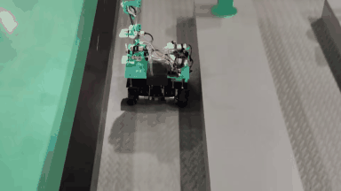

# Agricultural_robot · 果树对靶变量施药机器人

这台机器人在模拟果园的相邻垄道间往返行驶。**STM32H750VBT6** 运行 FreeRTOS，读取三路激光测距、光电信号、偏航角和轮速，控制四轮底盘沿垄行驶、到端换行。仓库提供车端固件，支持 PS2 手动驾驶、自动行走，以及通过 USART2 指令控制施药泵启停。

## 工作演示

[](Docs/demo/机器人工作视频.mp4)

[观看完整实拍《机器人工作视频》（36 秒）](Docs/demo/机器人工作视频.mp4)

场地中的红绿树形标志标出模拟作业位置。约第 6 秒可以看到机器人在灰色垄道间行驶，第 16 秒的俯视画面能看清车身与垄边的间距，第 29 秒的全景展示了垄端和相邻通道的位置。

## 竞赛成果

| 赛事 | 项目获奖 |
| --- | --- |
| iCAN 大学生创新创业大赛“算能杯”RISC-V 开源技术挑战赛 | **国家级二等奖** |
| 国际大学生智能农业装备创新大赛 | **国家级优秀奖** |

## 工程亮点

- **树莓派视觉识别与对靶施药。** 树莓派在 Linux 上运行 OpenCV，通过阈值分割提取候选区域，再根据图像特征识别并定位果树目标。树莓派负责判断作业目标，STM32H750VBT6 负责底盘运动和施药泵启停。本仓库提供 STM32 车端实现。
- **基于目标距离的 PID 调速。** 接近垄端时，位置式 PID 根据 ToF 实测距离与设定距离的偏差调整底盘前后速度；沿垄行驶时，利用左侧距离和偏航角纠偏。四轮各自用增量式 PID 跟踪目标轮速，通过统一的电机接口更新 PWM。[运动控制](Core/Src/freertos.c) · [PID 实现](PID/pid.c) · [电机驱动](BSP/robot_motor.c)
- **按控制时序划分 FreeRTOS 任务。** 底盘控制任务的优先级高于路线决策和传感器采集任务。测距任务把前、后、左三路读数作为一组，覆盖写入单槽队列；电机任务直接读取最新样本，无需等待下一轮测距完成。[任务调度与数据流](PROJECT_GUIDE.md#任务间的数据传递)
- **串口收帧与指令执行解耦。** USART2 通过循环 DMA 和环形缓冲区接收连续字节。状态机拼合分批到达的帧，通过长度和 CRC 校验后，按命令表解码 TLV 字段，再由回调更新业务状态。ACK 丢失时，发送端可以原样重传，接收端只补发确认。[串口接收](BSP/robot_uart.c) · [协议解析](modules/robot_link.c)
- **通信异常时停车关泵。** 已建立会话后，若 500 ms 内没有新的有效心跳，车端锁存停车并撤销泵输出。通信任务持续失去进度时，电机任务停止喂狗。回归测试覆盖了 ACK 丢失、心跳到期和故障输出归零。[发送端测试](tests/test_robot_peer.py) · [固件仿真](tests/check_firmware_elf.py)

## 快速开始

**在电脑上验证通信。** 准备 Python 3.8 或更高版本，以及可在终端直接调用的 GCC、Clang 或 MSVC。在仓库根目录运行以下命令，无需连接开发板。

```bash
python tests/run_host_tests.py
```

通过时会显示 `byte_ring: PASS`、`robot_link: PASS`，随后是两个发送端测试的 `OK`。

**打开固件工程。** 在 Keil µVision 中打开 [RTOS_HAL.uvprojx](MDK-ARM/RTOS_HAL.uvprojx)，选择目标 `RTOS_HAL` 并执行 **Build Target**。工程配置使用 ARM Compiler 5.06 update 5 和 `Keil.STM32H7xx_DFP 3.0.0`。引脚与外设配置见 [CubeMX 工程](RTOS_HAL.ioc)。

[工程指南：硬件分工、任务数据流、通信与停车条件、仿真复现](PROJECT_GUIDE.md)
